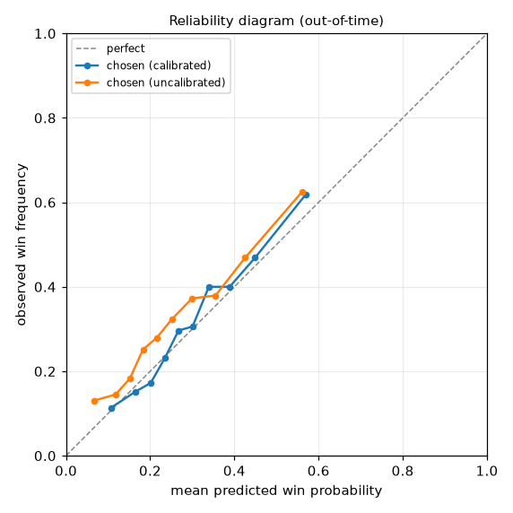
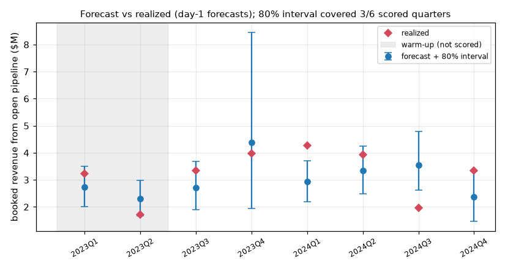

# PipelineTruth: calibrated deal-propensity and forecasting with honest limits

A propensity and forecast model for synthetic CRM data that is **calibrated, backtested and validated, and that states where it can't be trusted.** Every run regenerates a model card whose "do not use when..." and "known failure modes" sections are computed from that run's own evidence.

## Demo (one command)

```bash
make setup   # once
make demo    # regenerates the data, trains, prints the top deals, opens the model card in your browser
```

`make demo` runs the whole pipeline (~25 s), prints the interval-coverage result and the top-10 prioritized deals with reason codes, and opens `artifacts/model_card.html` (the auto-generated `model_card.md` with its figures inlined). The same files are in `artifacts/`: `model_card.md`, `priorities.md`, `priorities.csv`.

## Results at a glance

Figures from the default run (seed 42); `make figures` copies fresh ones from your latest run into `docs/`.

**Calibration** - reliability diagram on pooled out-of-time folds, before and after Platt calibration:



**Backtest and interval coverage** - day-1 quarterly forecasts with 80% intervals against what was actually booked. The grey band is warm-up, not scored:



| Measured (out-of-time) | Value |
|---|---|
| Brier / base-rate Brier | 0.194 / 0.217 (skill ~0.10) |
| ECE after calibration (raw: ~0.07) | 0.039 |
| AUC | ~0.70 |
| 80% interval coverage, total forecast | **3 of 6 quarters (50%)**, 95% CI ~19-81% |
| 80% interval coverage, segment-quarters | 14 of 18 (78%) |

Interval coverage is **below nominal** and the README and model card say so; with six scored quarters it cannot be estimated tightly.

**Auto-generated model card:** every run rewrites `artifacts/model_card.md` with performance by segment, known failure modes, drift status and a "do not use when..." section. Its structure: summary, do-not-use, failure modes, evaluation protocol, calibration, segment performance, forecast, data quality, drift.

### Resume line (matches the measured numbers)

> Built a calibrated deal-propensity and forecasting pipeline (DuckDB SQL, scikit-learn/LightGBM, FastAPI, MLflow) with time-based backtesting and data-quality gates; Platt calibration cut ECE from ~0.07 to ~0.04, and a measured-coverage check showed the forecast intervals under-covering (3/6 quarters at an 80% nominal level), which the auto-generated model card reports as a known limit.

## Features

| Area | What it does |
|---|---|
| Synthetic CRM | Seeded generator with seasonality, quarter-end pull, a mid-2024 drift event, and deliberate mess: missing amounts / lead sources / industries, non-positive and 20x outlier amounts, stale CRM close dates, duplicate accounts under name variants, duplicate opportunity rows, close-before-create dates, orphan activities |
| SQL pipeline | Plain DuckDB SQL files (`sql/`): staging and dedupe, data-quality rules with `error` / `warning` severity, point-in-time feature table |
| Models | Logistic-regression baseline vs LightGBM, both with identical preprocessing |
| Backtesting | Rolling-origin quarterly folds; training uses only deals whose outcome was already known. No random splits anywhere |
| Calibration | None vs Platt vs isotonic, fitted on a *later* time slice than the model; Brier, Brier skill vs base rate, ECE, log loss, reliability diagrams |
| Forecast | Quarterly revenue = sum(amount x P(win) x P(close in quarter)); Monte Carlo intervals widened by a factor learned from earlier quarters; **coverage measured** and reported with a Wilson CI |
| Model card | `artifacts/model_card.md`: performance by segment / lead source / amount band, failure modes, drift status, do-not-use list, DQ summary, next-quarter forecast |
| Serving | FastAPI `/score` (probability + reason codes + trust flags), `/priorities`, `/model-card`, `/health` |
| Prioritized deals | `artifacts/priorities.md|csv`: open deals ranked by expected value with up to 3 reason codes and a trust flag each |
| Tracking | MLflow (embedded SQLite backend) logs params, metrics and artifacts per run |
| Drift | Hand-rolled PSI for numeric / categorical features and the score distribution |

## Architecture

```
synth.py ──CSV──▶ sql/01_staging ─▶ sql/02_data_quality ─▶ sql/03_features   (DuckDB, warehouse.py)
                                                               │ features (1 row per deal @ created+14d)
              ┌────────────────────────────────────────────────┤
              ▼                                                ▼
   backtest.py (time folds, model x calibrator)        drift.py (PSI, train vs last 90d)
              │ chosen model/calibrator                        │
              ▼                                                │
   forecast.py (pipeline yield + intervals + coverage)         │
              │                                                │
              ▼                                                ▼
   pipeline.py ─▶ final bundle.joblib, priorities, plots ─▶ evaluation.py ─▶ modelcard.py ─▶ model_card.md  (+ MLflow)
                                       │
                                       ▼
                       api.py (FastAPI) ── scoring.py (reason codes, trust flags)
```

## Setup, run, test

Requires Python 3.10+ (developed on 3.14). No services, secrets or Docker needed: DuckDB and SQLite (MLflow) are embedded.

```bash
make setup      # creates .venv and installs requirements.txt
make demo       # train and then open the model card + print top deals
make train      # generate data -> SQL -> backtest -> forecast -> model card (~25 s)
make figures    # refresh docs/*.png from the latest run
make test       # 34 tests, ~15 s
make serve      # API on http://127.0.0.1:8000  (interactive docs at /docs)
```

Without make: `python -m pipelinetruth.pipeline [--n-opps N] [--seed S] [--reuse-data] [--no-mlflow]`.

Try the API:

```bash
curl -s localhost:8000/health
curl -s -X POST localhost:8000/score -H 'content-type: application/json' \
  -d '{"deals":[{"opp_id":"X1","amount":42000,"segment":"MidMarket","lead_source":"Referral","n_activities_snap":14,"n_meetings_snap":4,"stage_ord":3}]}'
curl -s 'localhost:8000/priorities?top=5'
```

Browse MLflow runs: `mlflow ui --backend-store-uri sqlite:///artifacts/mlflow.db`.

Configuration is via environment variables (see `.env.example`; all optional): `PT_DATA_DIR`, `PT_ARTIFACT_DIR`, `PT_SEED`, `PT_N_OPPS`, `PT_SNAPSHOT_DAYS`, `PT_INTERVAL_LEVEL`, `MLFLOW_TRACKING_URI`. `data/` and `artifacts/` are generated and git-ignored; `docs/` holds the two committed README figures.

## What the default run shows (seed 42, 7,000 deals)

These are honest, not flattering, and the card says so:

- 6 scored out-of-time folds (2023Q3-2024Q4): Brier 0.194 vs 0.217 for always predicting the base rate (skill ~0.10), ECE 0.039, AUC ~0.70. Day-14 CRM data only moderately predicts outcomes.
- **Logistic regression + Platt beat LightGBM**, and calibration cut ECE from ~0.07 (raw) to ~0.04. The simulated world is close to logistic, so the simpler model wins; the choice is made from data, not assumed.
- The nominal 80% total-forecast interval covered **3 of 6 quarters** (95% CI for true coverage ~19-81%): too few quarters to claim anything stronger, and the card flags under-coverage. About 38% of booked revenue comes from deals not in the day-1 pipeline, so this is a pipeline-yield forecast, not a bookings forecast.
- Drift status `warn`: logged activity fell after the simulated mid-2024 CRM change.

## Key design decisions

- **Snapshot modelling.** Each deal is scored once, at `created_date + 14 days`. All features (activities, stage, account/owner history) are computed point-in-time in SQL, and a test deletes every post-snapshot event to prove features don't change. Limitation: a score does not update as the deal evolves.
- **Time-based everything.** Fold training sets contain only deals with `closed_date < fold start`, so the recent training cohort over-represents fast closers. That bias is real-world and is included in the measured results. Calibrators are fit on the latest 25% of the training window.
- **Selection discipline.** Folds are split into warm-up (seed forecast-error history), selection (choose model x calibrator by Brier) and held-out folds (never used to choose). The model card labels each fold's role.
- **Data quality drives behaviour, not just reports.** `error` rules (missing/non-positive amount, close before create, unknown account) quarantine a record: it is excluded from training, forecasting and the priorities table, and the API returns `rejected` rather than a number. `warning` rules (stale close date, duplicate account, missing lead source, amount outlier) keep the record but add trust flags.
- **Duplicate accounts** are resolved in SQL by a canonical key (lowercased name without punctuation or legal suffix), so account-history features aggregate across variants.
- **Forecast intervals.** Independent-Bernoulli Monte Carlo is too narrow (model error, correlated outcomes), so the interval is widened by a factor `k >= 1` from the standardised errors of *earlier* quarters only; measured coverage on later quarters is reported rather than assumed. Timing uses empirical cycle lengths of matured won deals to avoid censoring bias.
- **Reason codes** are additive log-odds contributions (SHAP via LightGBM `pred_contrib`, coefficient x value for logistic regression), verified by a test that contributions plus bias reproduce the raw logit. They explain the raw score; calibration is monotone so directions are preserved.
- **Trust flags** on every score: out-of-training-range numerics, unseen categories, DQ warnings, low-confidence segments (from the backtest), and global drift alert.
- **Drift monitoring** uses PSI. Cumulative history counts (`account_prior_*`, `owner_prior_*`) and the seasonal creation quarter are exempt because they drift by construction; leaving them in produced permanent false alarms.
- **Not implemented:** the optional ONNX export and C++ inference service, and Evidently (drift checks are hand-rolled instead). The synthetic data means absolute numbers don't transfer to a real CRM.

## Layout

```
pipelinetruth/   synth, warehouse, models, calibration, backtest, forecast, drift,
                 evaluation, scoring, modelcard, pipeline (CLI), api, config
sql/             01_staging.sql, 02_data_quality.sql, 03_features.sql
tests/           generator + SQL/point-in-time, calibration, leakage-free splits,
                 forecast/drift, end-to-end pipeline + API
```
